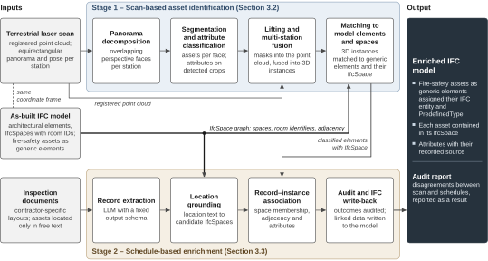
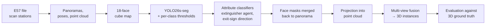

# FSE-Scan2BIM: Fire-Safety Equipment from Laser-Scanner Panoramas to 3D Instances


This repository holds the code for **Stage 1** of an ongoing research project, *Semantic Enrichment of As-Built BIM with Fire Safety Equipment: Linking Laser-Scan Detections to Inspection Schedules through Space Topology* (manuscript in preparation).

As-built BIM models made from laser scans have good geometry but almost no asset information. Small fire-safety assets such as extinguishers, exit signs, smoke detectors and call points are often missing, or are modelled only as generic shapes with no type or properties. This code detects these assets in the 360° panoramas that a terrestrial laser scanner records at each station. It then lifts the detections into the point cloud as 3D object instances with attributes (extinguisher agent type, exit-sign arrow direction) and evaluates them against a 3D ground truth.

Stage 2 links these instances to contractor inspection schedules through IfcSpace topology and writes the result into the IFC model. Its code will be released together with the paper.



---

## Pipeline



| Step | What happens | Where |
|---|---|---|
| 1 | Read the E57, map scan indices to station numbers, extract panoramas and poses, subsample each station's cloud | `scan_io/` |
| 2 | Build the training set: frames from 360° video, 18-face cube maps, Fire-ART filtered to the 12 classes, split by building | `imagery/`, `dataset/` |
| 3 | Train the segmentation model and the attribute classifiers, choose per-class thresholds | `detection/`, `attributes/` |
| 4 | Run inference on whole panoramas: 18 faces at 1024 px, thresholds, attribute classifiers on the crops, faces merged back into panorama instances | `detection/pano_inference.py` |
| 5 | Map each mask pixel to its 3D point, then fuse detections of the same object across stations | `projection/pano_seg_to_cloud.py` |
| 6 | Build the 3D ground truth and evaluate against it | `ground_truth/`, `evaluation/` |

**Classes (12):** Fire Extinguisher, Fire Alarm, Fire Hose Reel, Fire Exit Sign, Fire Indicator, Smoke Detector, First Aid Kit, AED, Fire Call Point, Fire Blanket, Emergency Door Release, Evacuation Chair.

---

## Repository layout

```
fse-scan2bim/
├── README.md
├── LICENSE
├── requirements.txt
├── .gitignore
├── docs/
│   └── framework.svg
│
├── scan_io/                              # Laser-scan input (E57)
│   ├── inspect_e57.py                    # list scans, images and poses in an E57 file
│   ├── extract_e57.py                    # export panoramas, poses and points per station
│   ├── check_pano_fov.py                 # panorama field of view and angular pixel size
│   ├── station_map.py                    # E57 index → station number, panorama pairing, floor by scanner height
│   └── subsample_e57_stations.py         # one voxel-subsampled PLY per station
│
├── imagery/                              # 360° image handling
│   ├── extract_and_filter_frames_batch.py  # frames from 360° video: blur filter + perceptual-hash dedup
│   ├── cubemap_convert_v2.py             # equirectangular → 18 overlapping faces (with manifest)
│   └── cubemap_convert_for_training.py   # same, flat output for annotation; also used by inference
│
├── dataset/                              # Training-set preparation
│   ├── filter_remap_fireart.py           # filter Fire-ART to the 12 classes and renumber them
│   ├── rename_firenet.py                 # prefix FireNet images so names never collide
│   ├── dataset_stats.py                  # per-class, per-location and per-video statistics (read-only)
│   └── make_split.py                     # train/val/test split by location (whole buildings held out)
│
├── detection/                            # Segmentation model
│   ├── train_eval.py                     # train and evaluate one configuration
│   ├── kaggle_train.ipynb                # the same, as a Kaggle notebook (T4 GPU)
│   ├── compare_runs.py                   # per-class comparison across runs and seeds
│   ├── choose_thresholds.py              # F1-optimal per-class confidence thresholds on held-out data
│   ├── pano_inference.py                 # full-panorama inference: faces → panorama instances + attributes
│   └── view_masks.py                     # full-resolution views of the inference masks
│
├── attributes/                           # Fine-grained attribute classifiers on detected crops
│   ├── crop_instances.py                 # one crop per labelled instance, for sorting by attribute
│   ├── probe_separability_v4.py          # extinguisher agent: frozen DINOv2 linear probe, grouped CV
│   ├── train_yolo_cls_cv.py              # exit-sign direction: YOLO26n-cls, grouped CV
│   ├── train_attribute_cnn_v2.py         # CNN baseline (ResNet-18 / EfficientNet) for the same task
│   └── classify_subtypes.py              # apply the attribute models to new crops
│
├── projection/                           # 2D → 3D
│   ├── project_mask_to_3d.py             # one mask → 3D points via a spherical range image
│   ├── colorize_cloud_from_pano.py       # colour the whole cloud from a panorama (sanity check)
│   ├── diagnose_azimuth_convention.py    # the same under four candidate angle conventions
│   └── pano_seg_to_cloud.py              # visibility, bleed removal, multi-view fusion → 3D instances
│
├── ground_truth/                         # Building the 3D ground truth
│   ├── pano_clicks_to_3d.py              # point clicks on panoramas → one 3D entry per object
│   ├── cutout_instances.py               # per-point instance masks (plane removal + clustering)
│   └── edit_gt.py                        # relabel, merge or delete ground-truth objects
│
└── evaluation/
    └── evaluate_vs_gt.py                 # P/R/F1, AP, centre error, mask IoU, attribute accuracy, figures
```

`detection/pano_inference.py` imports helpers from `attributes/` and `imagery/`; a short block at the top of the script adds those folders to the import path, so run the scripts from anywhere.

---

## Installation

```bash
git clone https://github.com/Arnob-Adhikary/fse-scan2bim.git
cd fse-scan2bim
python -m venv .venv
.venv\Scripts\activate            # Windows   (Linux/macOS: source .venv/bin/activate)
pip install -r requirements.txt
```

Tested on Windows with Python 3.14.4, ultralytics 8.4.171 and torch 2.11 (CUDA 12.8). Training ran on a Kaggle T4 GPU, and inference on a RTX 3050 4 GB laptop GPU. `ffmpeg` must be on the PATH for frame extraction.

## Usage

Every script describes its inputs at the top of the file and lists all options with `-h`. The paths below are examples.

**Case study: from scan to evaluated 3D instances**

```bat
:: 1. Scan input
python scan_io\extract_e57.py site.e57 extract\
python scan_io\subsample_e57_stations.py site.e57 cloud_5mm\ --voxel 0.005
python scan_io\station_map.py site.e57 stations\ --rename-dir cloud_5mm extract --apply

:: 2. Inference on the panoramas
python detection\pano_inference.py --pano-dir panos\ --yolo best.pt --thresholds thresholds.json ^
       --probe extinguisher_dinov2s_448.joblib --exit-model exit_sign_yolo26n_cls.json

:: 3. Projection and multi-view fusion (one merged cloud per floor)
python projection\pano_seg_to_cloud.py --pred-dir panos_inference_<time>\ --pose-dir extract\ ^
       --stations stations\stations.csv --cloud floor1_5mm.ply --floor 1 --out-dir pred3d\floor1

:: 4. Ground truth and evaluation
python ground_truth\pano_clicks_to_3d.py --json-dir pano_labels\ --pose-dir extract\ ^
       --cloud floor1_5mm.ply --stations stations\stations.csv --out-dir gt\
python ground_truth\cutout_instances.py --cloud floor1_5mm.ply --instances gt\instances_3d.csv ^
       --out-dir gt\cutout --floor 1
python evaluation\evaluate_vs_gt.py --gt site=gt\cutout --run full site=pred3d\floor1 ^
       --stations stations\stations.csv --out-dir eval\
```

**Training**

```bat
python dataset\filter_remap_fireart.py "Fire-ART_Part 2" fireart_filtered ^
       --src-classes classes_fireart.txt --dst-classes classes_fse.txt
python dataset\make_split.py --root dataset_root\
python detection\train_eval.py --data split\data.yaml --model yolo26s-seg.pt --name EXP007_seed0
python detection\choose_thresholds.py -h
python attributes\train_yolo_cls_cv.py crops\exit_signs --model yolo26n-cls.pt --imgsz 384 ^
       --swap-flip "direction left" "direction right" --group-by location --location-map location_map.csv
```

---

## Technical notes

**Panorama-to-point mapping.** Instead of casting rays and tuning a radius threshold, the station's point cloud is rendered into a spherical range image on the same pixel grid as the panorama. Every mask pixel then maps straight to its nearest visible 3D point. Camera-frame coordinates are `R.T @ (p_world - t)`, using the pose stored in the E57.

**Azimuth convention.** The scanner's panoramas turned out to be mirrored in azimuth compared with the textbook spherical convention: the correct mapping is `az = atan2(-y, x)`. I found this by colourising the whole point cloud from one panorama under four candidate conventions and comparing each with the real room (`projection/diagnose_azimuth_convention.py`).

**Multi-view fusion.** Each object is usually seen from several stations. For each station, `pano_seg_to_cloud.py` keeps only the points visible from that station. It then removes mask bleed onto the walls and ceilings behind small objects using a range-gap filter and a class-size filter. Detections from different stations are grouped by point overlap or by class-specific centre distance. The class and the attributes are decided by confidence-weighted votes.

**Evaluation protocol.**
- Training, validation and test are split by building. The test set is three whole buildings that the model never sees during training.
- Model choices were made on the held-out buildings, using a selection rule fixed in advance. Each candidate was trained with 3 seeds, because identical runs differed by up to 0.044 mAP.
- Per-class thresholds were chosen once on the held-out buildings and then frozen before the case study.
- Cross-validation for the attribute classifiers is grouped by source video or location, so near-identical views of one object never appear in both training and test folds.

---

## Results

### Segmentation on held-out buildings
Mask mAP50-95 over 12 classes; 518 test instances in 3 buildings not used for training.

| Model | Training data | Mask mAP50-95 | Mask mAP50 |
|---|---|---|---|
| YOLO26n-seg | own | 0.583 | 0.749 |
| YOLO26n-seg | own + public | 0.570 | 0.742 |
| YOLO26s-seg | own (3 seeds) | 0.609 ± 0.024 | 0.784 ± 0.014 |
| **YOLO26s-seg** | **own + public (3 seeds)** | **0.620 ± 0.035** | **0.788 ± 0.036** |

Raising the image size from 640 to 1024 px improved mask mAP50-95 from 0.47 to 0.61 in an earlier label version. Most of the gain came on small objects (alarms, indicators, call points).

### Attribute classifiers

| Attribute | Method | Result |
|---|---|---|
| Extinguisher agent (CO2 vs foam/powder), 282 crops | frozen DINOv2-small, linear probe, 448 px | 99.6% accuracy (balanced 99.4%) |
| Exit-sign direction (4 classes), 270 crops | YOLO26n-cls |97.9% accuracy (balanced 98.2%) |
| Exit-sign direction, baseline | ResNet-18, 192×384, label-swapping flip | 95.2% |

### Case study: hotel, 137 scan stations (preliminary)
These figures are from the first run, before the ground truth was reviewed by a second annotator. They will change.

| | Precision | Recall | F1 |
|---|---|---|---|
| All detections | 0.53 | 0.88 | 0.66 |
| Scanner carrying case excluded* | 0.59 | 0.88 | 0.70 |

- Median 3D centre error: **1.0 cm**. Mean IoU of matched masks: 0.71.
- Attributes: extinguisher agent 4/4 correct, exit-sign direction 5/6.

\* The scanner's carrying case was moved along with the scanner to every station. It looks almost identical to a first-aid kit, and it caused 17 false positives.

---

## Data availability

The images, point clouds and BIM models come from professional scan-to-BIM projects in the Netherlands and cannot be shared publicly. They are available from the author on reasonable request, subject to approval by the data owner. This repository contains no project data and no model weights.

The public part of the training data is the Fire-ART dataset (Wen et al., 2025; arXiv:2511.01399), filtered and relabelled to the 12 classes above.

## My role

- **Arnob Adhikary:** research idea; pipeline design; 360° data collection and annotation; dataset and evaluation protocol; all experiments and analysis; code.
- Dorin Namrota Adhikari (co-author): annotation and ground-truth review.
- Alinda Bhattacharjee (co-author): annotation and ground-truth review.

Parts of the code were written with the help of an AI coding assistant. I designed, reviewed and tested every script on real data, and integrated them into this pipeline.

## Citation

Paper in preparation. Until it is published, please cite this repository:

```
Adhikary, A., Adhikari, D. N., & Bhattacharjee, A. (2026). FSE-Scan2BIM: fire-safety equipment from laser-scanner
panoramas to 3D instances. GitHub repository. https://github.com/Arnob-Adhikary/fse-scan2bim
```

## Licence

MIT (see `LICENSE`).

## Contact

Arnob Adhikary · adhi.arnob@gmail.com · arnob-adhikary-780625229
